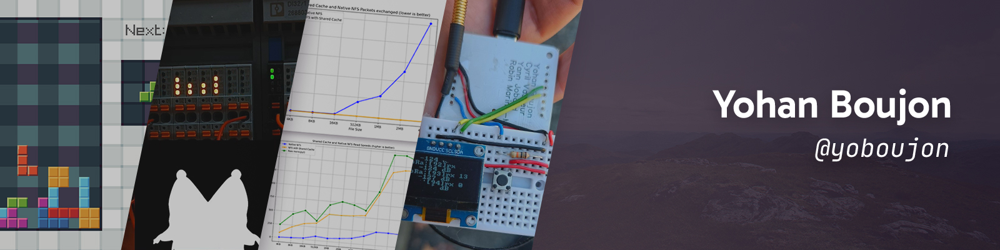

## Leaving my mark on this **world** ~ 🌍

	

> 🔩 I want to leave my mark on this complex world, mixing every bit of my knowledge to produce matter in every form possible.

 

- 🐧 **Main OS**: 
- 💻 **Prog. Flow**:     

- 🎓 **Education**: Engineering School in Informatics and Electronics
- 📚 **Hobbies**: Cinema, Reading papers, Space and Photography
- 🛠️ **Interests**: Embedded systems, Low-level, Game development, Retro computing, Kernel development
- 💬 **Languages**: French, English 

 

Moved *almost* everything to [codeberg](https://codeberg.org/yoboujon).
